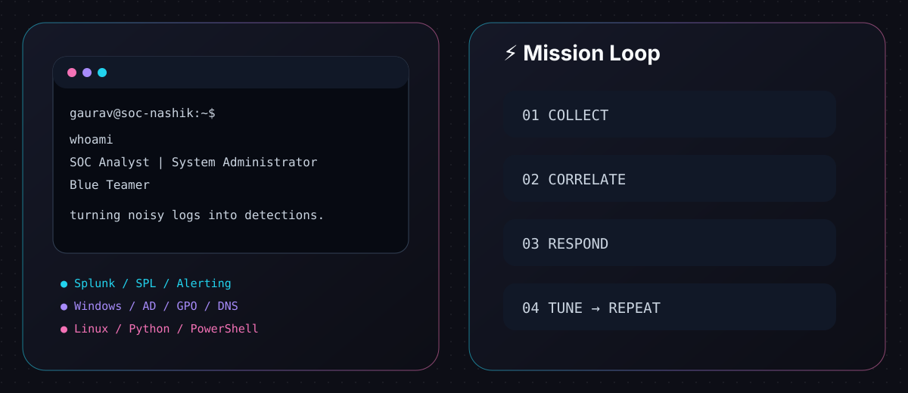
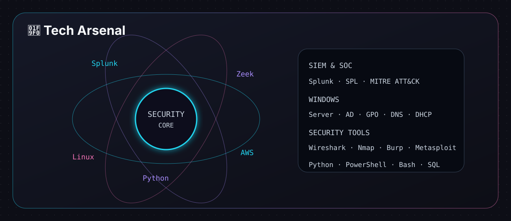
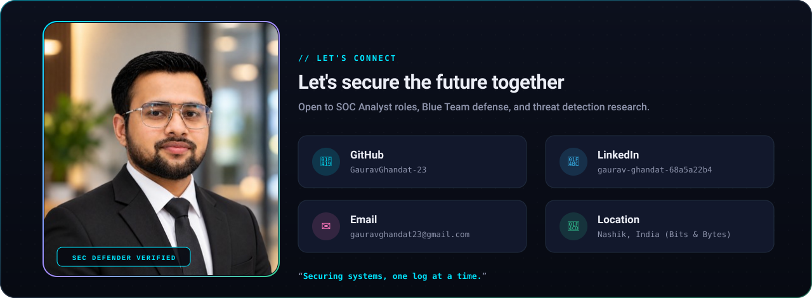

<div align="center">



<br/>

[](https://github.com/GauravGhandat-23)
[](https://github.com/GauravGhandat-23)


</div>

---

## 🖥️ whoami



---

## 🧰 Tech Arsenal



---

## 🎯 Detection Coverage

| Tactic | Technique | How I detect it | Data source |
|:--|:--|:--|:--|
| Credential Access | **T1110** Brute Force | Failed-auth spikes per source IP within time window + distinct usernames | Linux SSH / auth logs |
| Command & Control | **T1071.004** DNS | Abnormally long or high-volume queries per host (tunneling patterns) | Zeek `dns.log` |
| Command & Control | **T1071.001** Web | Near-constant connection intervals with low jitter (beaconing) | Zeek `conn.log` |
| Initial Access | **T1190** Public-Facing App | Traversal, SQLi and XSS patterns in web requests | Apache access logs |
| Multi-stage | Cross-source correlation | Linking network, host and cloud signals into one attack story | Zeek + SSH + Apache + GuardDuty |

<details>
<summary><b>🔬 Peek inside the detection lab: sample SPL (click to expand)</b></summary>

<br/>

> *Index and sourcetype names are configurable per SIEM environment.*

**SSH brute-force (T1110)**

```spl
index=linux sourcetype=linux_secure "Failed password"
| rex "from (?<src_ip>\d{1,3}(?:\.\d{1,3}){3})"
| rex "for (?:invalid user )?(?<user>\S+)"
| bin _time span=5m
| stats count AS attempts, dc(user) AS users_tried BY _time, src_ip
| where attempts > 10
| sort - attempts
```

**DNS tunneling (T1071.004)**

```spl
index=zeek sourcetype=bro:dns:json
| eval src='id.orig_h', qlen=len(query)
| stats count AS queries, dc(query) AS unique_queries, avg(qlen) AS avg_len BY src
| where avg_len > 40 AND unique_queries > 100
| sort - unique_queries
```

**C2 beaconing (T1071.001)**

```spl
index=zeek sourcetype=bro:conn:json
| eval src='id.orig_h', dst='id.resp_h'
| sort 0 src dst _time
| streamstats current=f last(_time) AS prev BY src dst
| eval delta=_time-prev
| stats count, avg(delta) AS avg_interval, stdev(delta) AS jitter BY src dst
| where count > 30 AND jitter < 5
```

**Web exploitation attempts (T1190)**

```spl
index=web sourcetype=access_combined
| where match(_raw, "(?i)(\.\./|union(\s|%20|\+)+select|<script|etc/passwd)")
| stats count, values(uri_path) AS paths BY clientip
| sort - count
```

</details>

---

## 🔬 Featured Projects

<table>
<tr>
<td width="50%" valign="top">

### 🔹 Enterprise Log Analysis & Threat Detection
`Splunk Enterprise` `Zeek` `Apache` `Linux SSH` `AWS GuardDuty`

- Centralized DNS, HTTP, SSH, Apache and cloud logs in one SIEM
- Wrote SPL detections for brute force, DNS tunneling, malware beaconing and web exploitation
- Built real-time alert rules for rapid incident response
- Correlated multi-source logs to surface complex attack stories

</td>
<td width="50%" valign="top">

### 🔹 SOC Monitoring Dashboard
`Splunk Enterprise` `SPL`

- Designed enterprise SOC dashboards tailored for analysts
- Visualized authentication anomalies, attack trends, firewall events and web traffic
- Built brute-force detection views for at-a-glance triage
- Turned raw telemetry into actionable security insight

</td>
</tr>
</table>

---

## 💼 Experience

**System Administrator — Bits & Bytes Services Pvt. Ltd, Nashik**  
Since **06/2025** · Windows Server & Linux infrastructure · Active Directory · GPO · DNS/DHCP · LAN/WAN/VPN · ITIL · hardening · patching · backup

---

## 🏆 Certifications

| Domain | Credentials |
|:--|:--|
| 🔴 **Offensive** | CRTA (Certified Red Team Analyst) · PEH / EH (Netleap) |
| 🔵 **Defensive** | Security Blue Team (Network Analysis) · arcX Threat Intelligence Analyst |
| ☁️ **Cloud** | Oracle OCI 2025 Architect Associate |
| 🛡️ **Cyber Foundations** | Google Professional Cybersecurity · Cisco Intro to Cybersecurity · Reliance Foundation Cyber Security Associate · Tech Mahindra Cyber Security Program |
| 🖧 **Infrastructure** | CCNA · MCSA · RHCSA · RHCE · Linux Fundamentals |

---

## 🎓 Education

**B.E. in Computer Engineering**, Brahma Valley College of Engineering, Nashik  
`06/2022 – 05/2025` · CGPA **7.66 / 10**

---

## 🚀 Where I'm Heading

- [x] Centralized log monitoring and multi-source correlation in Splunk
- [x] Real-time alerting and SOC dashboards
- [ ] Detection-as-code
- [ ] Automating repetitive triage with Python and PowerShell
- [ ] Deeper cloud security monitoring across AWS and OCI

---

## 📊 GitHub Analytics

<div align="center">


<br/>

</div>

---

## 🪪 Live SOC Dashboard



---

## 🐍 Contribution Snake

<div align="center">
<picture>
  <source media="(prefers-color-scheme: dark)" srcset="https://raw.githubusercontent.com/GauravGhandat-23/GauravGhandat-23/output/github-snake-dark.svg"/>
  <source media="(prefers-color-scheme: light)" srcset="https://raw.githubusercontent.com/GauravGhandat-23/GauravGhandat-23/output/github-snake.svg"/>
  
</picture>
</div>

---

## 📫 Connect



<br/>

<div align="center">

<a href="mailto:gauravghandat23@gmail.com"></a>
<a href="https://linkedin.com/in/gaurav-ghandat-68a5a22b4" target="_blank"></a>
<a href="https://github.com/GauravGhandat-23" target="_blank"></a>

<br/><br/>

<i>🔐 "Securing systems, one log at a time."</i>

</div>
